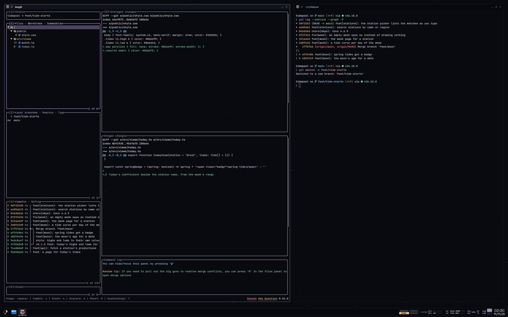

Chamfer is the theme of my KDE desktop and the terminal apps I live in. Its new default palette, Orbit, takes its values from [my self-hosted apps](/posts/orbit-apps), so going from a terminal to one of them no longer looks like changing machines: the same near-black ground, the same hairline frames, the same fonts, the same sky. One rule from the old Chamfer stayed: the chrome is grey, and a colour appears only for what it means.

<Stats
  items={[
    {"value": "7", "label": "colours with a meaning, all taken from the apps"},
    {"value": "10", "label": "apps themed besides KDE, from kitty to VS Code"},
    {"value": "7", "label": "palettes, Orbit the default"}
  ]}
/>

## The desktop takes the apps' values

My apps share one stylesheet, and Orbit copies its values rather than deriving its own. The window ground is the apps' page ground, `#090a10`, and what is raised sits a step up, `#11131a` and `#191c25`. Fill alone barely shows that close to black, so popups are framed by a hairline, the text colour at 20%, as the apps frame their boxes.

The interface font is Space Grotesk and the terminal's is JetBrains Mono, the apps' two faces. The prompt and yazi need Nerd Font icons, which kitty takes from Iosevka wherever JetBrains Mono has none. The wallpaper is the apps' starfield on the same ground, seeded so every rebuild draws the same sky.

## The apps' colours fit the cockpit rule

The old Chamfer followed the colour conventions of the FAA's guidance for electronic flight displays, AC 25-11B, and Orbit keeps them. The apps already had a colour for each state, so they map straight on, with magenta, the FAA's colour for targets, replaced by cyan:

- **White**, `#d8dbe6`: current data, such as window text and the prompt's path.
- **Light grey**, `#8a90a6`: labels, dividers, anything inactive, such as unfocused tabs and the prompt character.
- **Lavender**, `#b9a3de`: selected, such as the focused window's outline, the active pane and nvim's mode chip.
- **Cyan**, `#7cc4e8`, the apps' info colour: a target, such as the git branch, links and lazygit's rebase base.
- **Green**, `#7fd8a6`, the apps' success: normal or done, such as staged files.
- **Amber**, `#e6c07b`, the apps' warning: caution, such as modified files, commits to push and a lamp with something to do.
- **Red**, `#ff6b6b`, the apps' danger: act now, such as a failed command, a conflict or a failed unit.

Each app picks its own accent, so the selection had to be one of them. It is relay's lavender, 70° of hue from the cyan target; hubble's periwinkle, the other candidate, sits only 46° away and would read as a target.

Syntax is the one exception. On fish's command line and in nvim, VS Code, bat and lazygit's diffs, colour tells tokens apart, so the syntax keeps eight hues: red, amber and green from the states, plus vulcan's orange, pallas's sky, hubble's periwinkle, lyra's orchid and pulsar's pink.

## Load is work, not a fault

The panel has four widgets drawn like instruments. The engine widget shows CPU, GPU, memory and VRAM as tapes, and CPU and GPU stay white however busy they are: their temperatures carry the limits, amber from 80 °C and red from 90 °C. Memory turns amber from 80% and red from 90%. VRAM has no limit at all, since games fill it on purpose.

An annunciator holds four lamps for the machine's doctor, health, sync and pending reboot, dark when there is nothing to do. The Claude usage bars turn amber from 70% and red from 90%, with a cyan mark for where the pace says I should be. The network widget shows `VPN` in cyan and turns amber when traffic leaves an autoconnect VPN or there is no route.

## Chamfer no longer has chamfers

The theme is named after its old corners, cut at 45°. The apps round theirs, so Chamfer now does too: 4 px on windows and popups, 3 px on what is pressed inside them, never rounder than the box holding it. The decoration draws each rounded corner as a pixel staircase, with the outline following it, and nvim's floating windows get rounded borders. The name stays.

A window has a 5 px frame and a 28 px title bar. Title-bar buttons are 21 by 19 with 9 by 9 glyphs, see-through until hovered, and close fills red. The panel stays square, because Plasma cuts it where it meets the screen edge. The rest is flat, 1 px lines on the pixel grid, with no glow, shadow or gradient, and KDE keeps its animations.

## One generator writes every app's theme

`just chamfer-theme` runs a Bun script that writes, for each of the seven palettes, a KDE colour scheme, a window decoration, a cursor theme at four sizes, a global theme and a wallpaper, so any of them can be picked from KDE's settings. For the palette chosen, Orbit by default, it also writes the Plasma theme and the files read by kitty, fish, starship, nvim, lazygit, lazysql, bat, VS Code, yazi and Spotify, then applies them. Cockpit, the true-black palette set in B612, the typeface Airbus had made for cockpit screens, is one argument away.

None of the output is committed or edited by hand: to change the theme, I change the generator and run it again. The dotfiles commit plain Catppuccin configs instead, which the generated files sit on top of, so a machine without the theme still gets a dark one.

## The generator has no tests of its own

Eight tests pin the palettes, Orbit taking the apps' values as they are among them. The generator itself, 1,134 lines writing SVG, TOML, JSON, XML, INI and PNG files, has none, so a broken target shows up on screen, not in a check. And not everything goes through it: Herdr, the terminal app I moved to after tmux, has a theme I wrote by hand, so its agent states use their own colours. The theme lives in my dotfiles, which are private.
