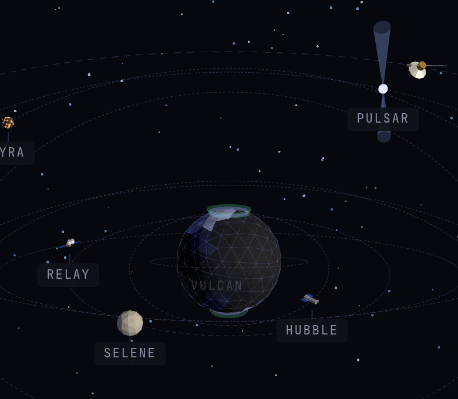

The apps I host for myself live in one monorepo called orbit, and every one of them is a kay app on Bun. That is half the reason they exist: they are where I find out whether my framework holds up in daily use, and kay is light on memory and fast, which counts when everything shares one server. I only replaced the services I can keep up myself, and I like that what is left forms an ecosystem of its own: one frame, one login in front, and each app calling the others. And what I say and read stays on my server. This post covers ten of them.

<Stats
  items={[
    {"value": "10", "label": "apps in this post, each a kay app on Bun"},
    {"value": "1", "label": "login in front of every app, with a second factor"},
    {"value": "~1,400", "label": "tests across those ten apps and their shared shell"}
  ]}
/>

<Note title="How the tests were counted">

`test(` and `it(` calls in the test files of the ten apps and the shell on 10 November 2026, counted by grep rather than by a run.

</Note>

## Each app does one job

- **lyra** keeps notes and memories in folders, with full-text search stemmed in English and French, wikilinks, backlinks and a revision for every save. Its MCP server is the memory my Claude Code sessions read, as [the harness post](/posts/claude-code-harness) explains.
- **pulsar** is an RSS reader driven by j, k and o. Each morning it writes a French podcast from my feeds and reads it aloud, with chapters and a transcript.
- **nymph** is the voice: speech-to-text with whisper on the GPU, French text-to-speech with phonon on the CPU, behind the OpenAI audio API. It has no page and is reachable only on a private Docker network.
- **selene** is a home assistant asked by text or voice. It switches lights, reads the weather, my calendar, the next trams and trains, and hubble's alerts.
- **pallas** is a docs library of offline books plus live `llms.txt` docs, with a research chat that answers with numbered citations.
- **vulcan** is a toolbox of one page per tool. Its pixel avatars and QR codes are open without the login, so any site can embed them.
- **hubble** scans repos, running images and the host for known vulnerabilities and end-of-life runtimes, and is the one place that sends alerts.
- **relay** manages the nginx sites in front of everything: certificates, the login, traffic, bans and up/down checks.
- **ceres** starts, stops and restarts the server's Docker stacks from one page, and logs every action.
- **atlas** is the dashboard, and the map of all the others.

## One shell frames them all

Every app depends on one workspace package, the shell. In `kay.config.ts`, one call sets the font, the favicon, the title template, error reporting to hubble and the check that a request came through the login. In each app's layout, one component draws the header, an app switcher and a Ctrl K palette.

The palette lists the app's own pages first, then fetches every other app's features from the browser, so Ctrl K in any app reaches a page of any other. The look is shared too: near-black, Space Grotesk, no glow or shadow, and each app picks only its accent colour.

## A request reaches an app only through relay

relay runs nginx in a container that reads one folder of generated config. The login is a separate kay app on kayjs-auth: no sign-up, accounts created from the command line, a TOTP second factor required, and nginx asks it about every request to a site behind the login.

The login alone would not stop a request sent straight to an app's port. So relay writes a key per site, nginx sends it as a header, and the app's kay config refuses any request without it. Nothing in relay needs root or the Docker socket: the generator writes the config, asks nginx to reload through a file, and rolls the folder back if nginx refuses it.

## The apps call each other

pulsar's podcast is three apps at work. pulsar picks the articles and a model writes the script, listing the foreign names it uses respelled for French, such as Copilot as "Copaïlotte". nymph reads the script with those respellings, and pulsar times the chapters from the voice's pauses.

selene uses the same voice: whisper turns what I say into text, and the answer comes back spoken. Its library tool asks pallas, which searches the offline books and pulsar's articles, one JSON step at a time, and answers with a list of sources. Every app sends its server errors to hubble.

## The map is a sky

atlas's `/sky` draws the apps in three.js as bodies around a wireframe Earth, each chosen for its name. hubble is a space telescope in low orbit, relay a communications satellite with its dishes facing Earth, selene the Moon. pallas tumbles on the steepest orbit, as the asteroid Pallas does, and vulcan is a molten planet on the tightest one, after the planet once thought to circle inside Mercury's.

Live state changes how a body pulses: relay's request rate, hubble's alerts, pulsar's unread count. Every repo with code on my Forgejo is a star, at the same place on every visit. Hovering a body stops its orbit and locks a reticle on it, a click flies the camera there and opens its panel, and the list beside the canvas is plain links that work without JavaScript.

## Every app moves to a new kay at once

All ten pin the same kay version, so a framework upgrade is ten apps to check in one go. The one app outside the monorepo, [my Temtem app](/posts/temtem-companion), takes the shell from my package registry instead, and it is still two minors behind. Each app also has its own CI workflow, and the shell's own release when it changes.

Some limits are on purpose. ceres can start Forgejo and Postgres but never stop or restart them. selene runs its tools without asking first, because it sits behind the login and the worst a call does is switch a light.
