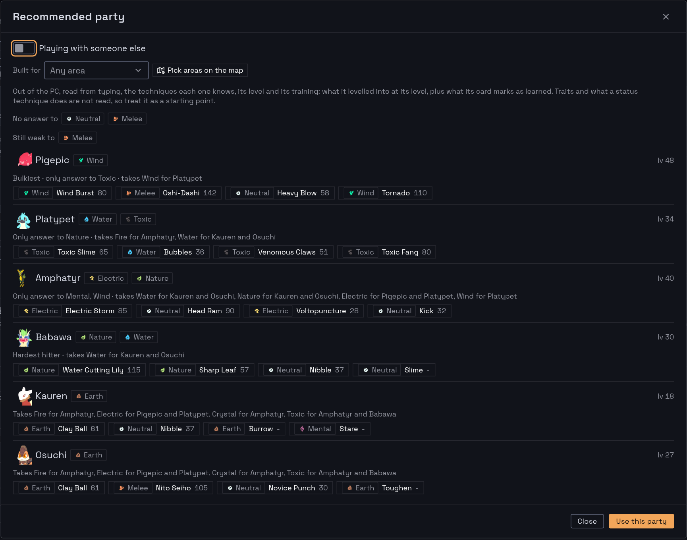

In a Temtem battle, I want to know what the foes are weak and strong against without leaving the game. My keyboard has a screen, so that is where it shows, as soon as the battle starts. Between battles, a web app keeps my box and recommends a team for the area I am heading to.

<Stats
  items={[
    {"value": "165", "label": "temtem in the vendored dataset, nothing fetched at runtime"},
    {"value": "14", "label": "MCP tools the keyboard's companion and Claude call"},
    {"value": "~470", "label": "tests, counted by grep across 51 files"}
  ]}
/>

<Note title="Photo to come: the keyboard's screen in a battle">

The keyboard's screen beside the game, showing the two foes and their matchups.

</Note>

## A battle reaches the keyboard as it starts

A companion app on my gaming PC notices the moment the game joins a battle. It captures the game window, reads the foes' name plates by OCR, and asks the web app what each one is weak and strong against. The answer goes to the keyboard's screen.

The OCR keeps only near-white pixels with a dark outline close by, which drops the sky and clouds behind a name. The gender sign often runs into the name, so the companion trims letters off the end until the app recognises a temtem.

## The app learns the game's French

I play in French. Temtem names are the same in both languages, but techniques, traits and gear are not, and there is no public French source to map them. So the app resolves whatever the screen says against the English dataset, and when only one candidate is left, it learns that spelling. It refuses to guess: a misread "Paharc" matches two temtem, so it matches none.

## A team for the area ahead

The Team tab holds my box, my party, a gear bag and a plan of the areas I am going to. The recommender builds a party from the box:

- Each type the party has an answer to scores, and a type with no answer costs as much. A second answer counts for a third of the first.
- Weaknesses cost and resistances give back, a 4x weakness counting twice.
- Each technique is read with its type bonus, the gear held, its stamina cost and any healing or self-damage.
- The party is built greedily, then members are traded one or two at a time until no trade reads better. The pair trades draw from a limited pool, so a full box stays under a second.

It picks the four techniques of each member together, for power and for the coverage the party still lacks, and hands out the gear in the bag. For a plan, the types met in those areas weigh more and a level shortfall costs. Every member comes with a reason in plain text, and an audit tool compares my current party with the recommendation.

The box is test data. Temtem art © Crema.

## The Tempedia fills itself

The companion also reads my save on the PC and sends the app the temtem I have seen and caught. Each list and each map area then marks them, so I can see what an area still holds for the Tempedia. Marks only ever go up: the game writes its save when it closes, so a mark made in the app may be newer than the save.

## A terminal overlay answers the same question by hand

Meta+Shift+T opens a borderless kitty window over the game: a fuzzy search over every temtem, with its types, matchups, techniques, locations and evolutions. It also lists all 78 type combinations, and a team view shows every attacking type against every member. The panels are rendered ahead of time, so a keystroke's preview is a `cat` and one image.

The same key closes it, and a KWin rule keeps it above the game, which has to run borderless windowed: exclusive fullscreen sits above anything kept on top.

## The data stays private

The dataset comes from a community API pinned at one commit, a wiki and a fan map of NPC positions, about 4.3 MB vendored in the repo. Some of it has no licence, which is fine for an app only I use and not for a public one, so the app stays behind my login. The OCR also reads plates at positions measured on the game's battle screen, so a redesign of that screen means measuring them again.
