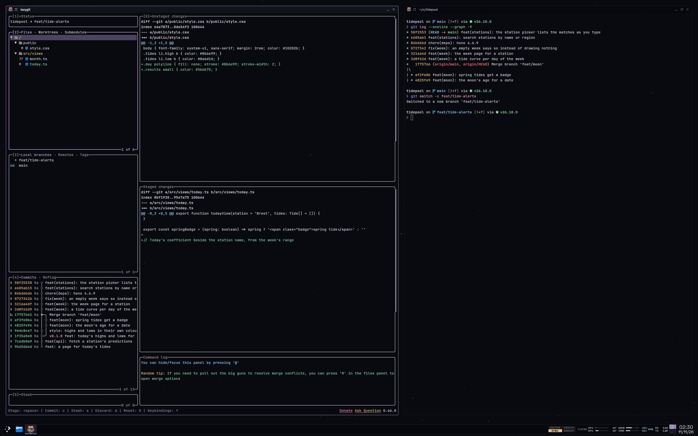

Chamfer est le thème de mon bureau KDE et des applis de terminal où je vis. Sa nouvelle palette par défaut, Orbit, prend ses valeurs à [mes apps auto-hébergées](/posts/orbit-apps), si bien que passer d'un terminal à l'une d'elles ne donne plus l'impression de changer de machine : le même fond presque noir, les mêmes filets fins, les mêmes polices, le même ciel. Une règle de l'ancien Chamfer est restée : le décor est gris, et une couleur n'apparaît que pour ce qu'elle signifie.

<Stats
  items={[
    {"value": "7", "label": "couleurs qui ont un sens, toutes prises aux apps"},
    {"value": "10", "label": "applis thémées en plus de KDE, de kitty à VS Code"},
    {"value": "7", "label": "palettes, Orbit par défaut"}
  ]}
/>

## Le bureau prend les valeurs des apps

Mes apps partagent une même feuille de style, et Orbit en recopie les valeurs au lieu de dériver les siennes. Le fond des fenêtres est le fond de page des apps, `#090a10`, et ce qui est surélevé se trouve une marche au-dessus, `#11131a` et `#191c25`. Si près du noir, le remplissage seul se voit à peine, donc les popups sont encadrées d'un filet, la couleur du texte à 20 %, comme les apps encadrent leurs boîtes.

La police de l'interface est Space Grotesk et celle du terminal JetBrains Mono, les deux polices des apps. Le prompt et yazi ont besoin des icônes Nerd Font, que kitty prend à Iosevka partout où JetBrains Mono n'en a pas. Le fond d'écran est le ciel étoilé des apps sur le même fond, tiré d'une graine pour que chaque génération dessine le même ciel.

## Les couleurs des apps entrent dans la règle du cockpit

L'ancien Chamfer suivait les conventions de couleur du guide de la FAA pour les écrans de vol électroniques, l'AC 25-11B, et Orbit les garde. Les apps avaient déjà une couleur par état, donc elles s'y posent directement, le magenta, couleur des cibles pour la FAA, étant remplacé par le cyan :

- **Blanc**, `#d8dbe6` : les données courantes, comme le texte des fenêtres et le chemin du prompt.
- **Gris clair**, `#8a90a6` : les libellés, les séparateurs, tout ce qui est inactif, comme les onglets sans focus et le caractère du prompt.
- **Lavande**, `#b9a3de` : la sélection, comme le contour de la fenêtre active, le panneau actif et la pastille de mode de nvim.
- **Cyan**, `#7cc4e8`, la couleur d'info des apps : une cible, comme la branche git, les liens et la base d'un rebase dans lazygit.
- **Vert**, `#7fd8a6`, leur succès : normal ou terminé, comme les fichiers indexés.
- **Ambre**, `#e6c07b`, leur avertissement : prudence, comme les fichiers modifiés, les commits à push et un voyant qui a quelque chose à faire.
- **Rouge**, `#ff6b6b`, leur danger : agir maintenant, comme une commande échouée, un conflit ou une unité en échec.

Chaque app choisit son propre accent, donc la sélection devait être l'un d'eux. C'est la lavande de relay, à 70° de teinte du cyan des cibles ; la pervenche de hubble, l'autre candidate, n'en est qu'à 46° et se lirait comme une cible.

La syntaxe est la seule exception. Sur la ligne de commande de fish et dans nvim, VS Code, bat et les diffs de lazygit, la couleur distingue les tokens, donc la syntaxe garde huit teintes : le rouge, l'ambre et le vert des états, plus l'orange de vulcan, le bleu ciel de pallas, la pervenche de hubble, l'orchidée de lyra et le rose de pulsar.

## La charge est du travail, pas une panne

Le panneau a quatre widgets dessinés comme des instruments. Le widget moteur montre CPU, GPU, mémoire et VRAM en bandes, et CPU et GPU restent blancs quelle que soit leur charge : ce sont leurs températures qui portent les limites, ambre à partir de 80 °C et rouge à partir de 90 °C. La mémoire passe à l'ambre à partir de 80 % et au rouge à partir de 90 %. La VRAM n'a aucune limite, puisque les jeux la remplissent exprès.

Un annonciateur réunit quatre voyants pour le diagnostic de la machine, sa santé, la synchronisation et un redémarrage en attente, éteints quand il n'y a rien à faire. Les barres d'usage de Claude passent à l'ambre à partir de 70 % et au rouge à partir de 90 %, avec un repère cyan là où le rythme dit que je devrais en être. Le widget réseau affiche `VPN` en cyan et passe à l'ambre quand le trafic quitte un VPN à connexion automatique ou qu'il n'y a plus de route.

## Chamfer n'a plus de chanfreins

Le thème doit son nom à ses anciens coins, coupés à 45°. Les apps arrondissent les leurs, donc Chamfer aussi désormais : 4 px pour les fenêtres et les popups, 3 px pour ce qui se presse à l'intérieur, jamais plus rond que la boîte qui le contient. La décoration dessine chaque coin arrondi en escalier de pixels, le contour le suivant, et les fenêtres flottantes de nvim ont des bordures arrondies. Le nom reste.

Une fenêtre a un cadre de 5 px et une barre de titre de 28 px. Les boutons de la barre de titre font 21 sur 19 avec des glyphes de 9 sur 9, transparents tant qu'on ne les survole pas, et la fermeture se remplit de rouge. Le panneau reste carré, parce que Plasma le coupe là où il touche le bord de l'écran. Le reste est plat, des traits de 1 px sur la grille de pixels, sans halo, ombre ni dégradé, et KDE garde ses animations.

## Un générateur écrit le thème de chaque appli

`just chamfer-theme` lance un script Bun qui écrit, pour chacune des sept palettes, un jeu de couleurs KDE, une décoration de fenêtre, un thème de curseur en quatre tailles, un thème global et un fond d'écran, de sorte que chacune se choisit dans les réglages de KDE. Pour la palette retenue, Orbit par défaut, il écrit aussi le thème Plasma et les fichiers lus par kitty, fish, starship, nvim, lazygit, lazysql, bat, VS Code, yazi et Spotify, puis les applique. Cockpit, la palette en noir pur composée en B612, la police qu'Airbus a fait dessiner pour les écrans de cockpit, est à un argument près.

Rien de cette sortie n'est commité ni modifié à la main : pour changer le thème, je change le générateur et je le relance. Mes dotfiles commitent à la place des configs Catppuccin simples, sur lesquelles les fichiers générés viennent se poser, si bien qu'une machine sans le thème a quand même un thème sombre.

## Le générateur n'a pas de tests à lui

Huit tests figent les palettes, dont Orbit qui prend les valeurs des apps telles quelles. Le générateur lui-même, 1 134 lignes qui écrivent des fichiers SVG, TOML, JSON, XML, INI et PNG, n'en a aucun, donc une cible cassée se voit à l'écran, pas dans une vérification. Et tout ne passe pas par lui : Herdr, l'application de terminal à laquelle je suis passé après tmux, a un thème écrit à la main, si bien que les états de ses agents ont leurs propres couleurs. Le thème vit dans mes dotfiles, qui sont privés.
