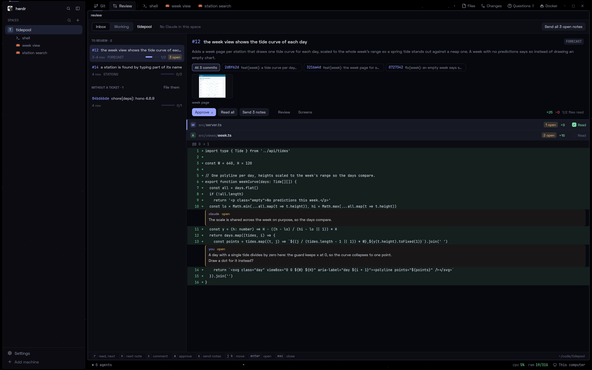
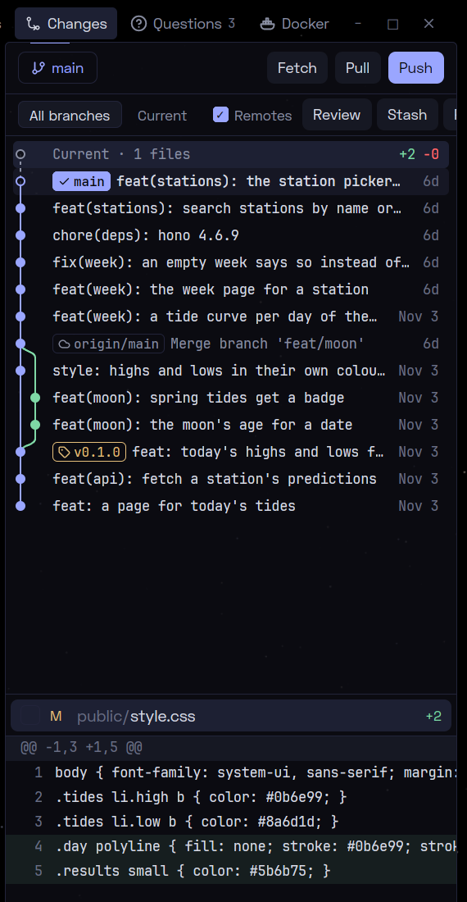
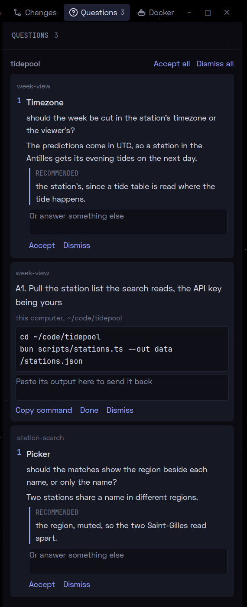

Claude Code commit après chaque tâche, dans plusieurs terminaux à la fois, et c'est à moi de relire chacun de ces commits. Deux mods font maintenant la plomberie : chaque commit de Claude atterrit dans une boîte de revue, les commits d'un ticket se lisent comme un seul diff, et mes notes retournent au Claude qui a écrit le code.



## Herdr faisait déjà ce que j'étais en train de construire

Les mods tournent dans [Herdr](https://herdr.dev), une application de terminal conçue pour les agents de code. Elle n'est pas de moi. Son runtime, `hc`, lance des programmes dans des terminaux qui restent en vie, et il sait quel terminal abrite un agent et si cet agent attend après moi. L'application ajoute par-dessus des espaces, des onglets et des panneaux, et une API de mods : un dossier avec un `main.js` qui dessine une vue native et appelle `hc`.

J'avais construit la même base sur tmux, environ 1 100 lignes de scripts. Herdr le faisait déjà, de série, alors je les ai supprimées : sur Herdr, je ne reconstruis pas la base, je construis par-dessus une bonne base que je peux personnaliser aussi loin que nécessaire.

## Chaque commit de Claude atterrit dans une boîte

Un hook de Claude Code lit la sortie de chaque commande shell à la recherche de la ligne que git affiche après un commit. Il repère aussi les commandes qui commitent en silence, un rebase, un cherry-pick ou un revert, et suit les `cd` et `git -C` pour trouver le dépôt. Chaque commit trouvé entre dans la boîte du projet avec le terminal d'où il vient. Le hook sort toujours avec 0, donc une revue ne peut jamais bloquer un commit.

Ouvrir l'onglet Review range aussi les commits non poussés de la branche datant des deux dernières semaines, ce qui rattrape ceux que j'ai faits à la main.

## Les commits d'un ticket se lisent comme un seul diff

Un commit dont le corps nomme un ticket, `#42 - the ticket's title`, rejoint l'élément de ce ticket, et l'élément montre un seul diff net au lieu de ses commits un par un. Les fixups, les amends et les copies rebasées ou cherry-pickées s'y replient aussi. Les commits sans ticket restent isolés, et Claude peut les ranger sous un ticket quand je le lui demande.

Une approbation mémorise les commits qu'elle couvrait, donc un nouveau commit sur un ticket approuvé le ramène dans la boîte.

## Une note retourne au Claude qui a écrit le code

Je lis au clavier : `r` marque un fichier comme lu et passe au suivant, `c` laisse une note sur une ligne, `a` approuve. `s` transforme les notes ouvertes en un seul prompt et le colle dans le Claude qui a fait le dernier commit de l'élément, si ce terminal l'exécute encore. Ce Claude corrige chaque point et marque sa note comme traitée, et je vois la correction arriver en nouveau commit dans le même élément.

Claude peut aussi relire un ticket lui-même et laisser des notes, mais approuver et rejeter restent à moi, et son skill le dit.

## Les écrans modifiés sont photographiés avant et après

Pour un ticket qui change une page, Claude écrit un court scénario Playwright : une route, les étapes pour atteindre l'état voulu, une taille de fenêtre. `review shoot` met la pile au parent du premier commit du ticket, prend les captures, la met au dernier commit, en prend de nouvelles, et place les deux images dans l'en-tête du ticket. Chaque projet a un preset pour sa connexion et ses étapes d'installation et de migration, exécutées seulement quand leurs fichiers ont changé.

Une étape en échec prend quand même sa capture, puisque l'image montre souvent pourquoi. Une exécution qui échoue à cause de la pile, et non du scénario, est relancée jusqu'à trois fois.

## Le panneau des changements est devenu un graphe de commits

Le second mod remplace le panneau des changements de Herdr par un graphe du dépôt du panneau actif : une voie par branche, le travail non commité en première ligne, et les fichiers et le diff de la ligne que je choisis. Un clic droit sur un commit, une branche ou un tag propose ce que git permet, du cherry-pick au reset. Une ligne de ticket dans le corps d'un commit devient un lien vers son ticket Forgejo, et un ticket s'ouvre dans l'onglet Review.



## Les questions ouvertes de Claude tiennent dans un panneau

Mes sessions Claude posent leurs questions sans attendre la réponse, comme l'explique [l'article sur le harness](/posts/claude-code-harness). Les labels de Herdr les sortent de chaque terminal, et un panneau les liste sous forme de cartes groupées par projet, chacune avec sa réponse recommandée. Accepter envoie la recommandation à ce Claude, une zone de réponse envoie tout le reste. Une commande que Claude me remet s'affiche avec un bouton de copie et une zone pour coller sa sortie en retour.



## La barre d'état lit la machine où tourne un espace

Un espace Herdr peut vivre sur une autre machine que celle devant laquelle je suis. La barre d'état affiche le CPU et la RAM de la machine de l'espace affiché. Toutes les trois secondes, tant que la fenêtre est active, elle y lance un seul `cat /proc/stat /proc/meminfo` : le chiffre du CPU est la part occupée entre deux relevés, donc le premier passage n'affiche que la RAM, sous la forme `9.4/31G`. Les deux chiffres passent à l'ambre à 70 % et au rouge à 90 %.

Le panneau des questions et la barre d'état sont des mods de mes dotfiles, absents du dépôt public ci-dessous.

## La boîte fait confiance à la sortie de git

Le hook repère les commits en lisant ce que git a affiché, donc un commit fait par un outil qui affiche autre chose passe inaperçu jusqu'à l'ouverture de l'onglet Review, qui range les commits non poussés. Un shoot n'annule pas les migrations, c'est pourquoi il tourne sur une copie jetable de la pile, jamais celle sur laquelle je travaille. Le panneau git est une copie du panneau des changements de Herdr, donc un correctif en amont ne l'atteint pas. Et `bun run setup` doit être relancé après chaque pull.

## L'essayer

Les mods sont sur [GitHub](https://github.com/Kayno0o/herdr-mods). Ils demandent Linux, [Herdr](https://herdr.dev), Claude Code, Bun et git :

```sh
git clone https://github.com/Kayno0o/herdr-mods.git
cd herdr-mods
bun install
bun run setup
```

`setup` installe les deux mods, la touche Ctrl+Shift+R, le hook de commit et le skill de revue, et télécharge le Chromium utilisé par les shoots. Le dépôt reste là où il a été cloné, puisque les mods pointent dedans.
